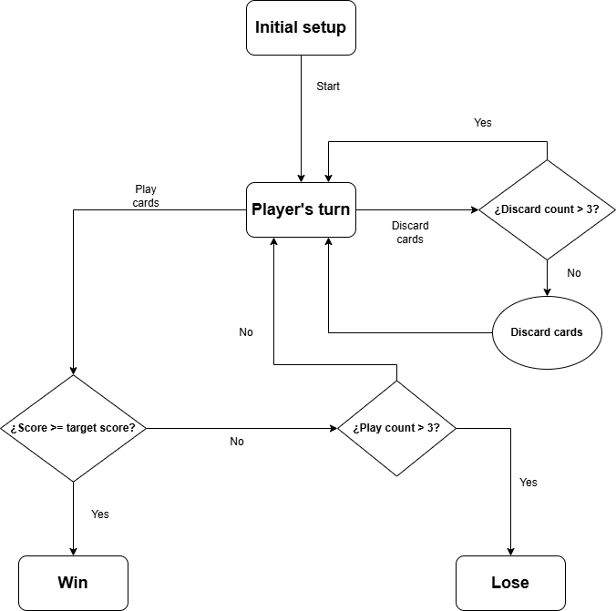

## Design Decisions

### Why were these design decisions made?

The project was designed with a clear separation of responsibilities to ensure scalability and maintainability:

- **Model Integrity**: The `Hand` class is responsible only for managing cards and jokers, while evaluation logic is strictly separated into specific classes (`PokerHand`, `HandPriority`).
- **Scoring Modularity**: The scoring calculation delegates responsibility to specific components interacting in the game via the Double Dispatch pattern, preventing monolithic `if/else` structures.
- **Dumb View, Smart Controller**: The graphical interface (`MalatroApp`) acts strictly as a "dumb" View. It handles no game logic, math, or object instantiation. Its sole responsibility is rendering media and forwarding user clicks to the `Controller`, which processes the business logic.

This architecture makes the system highly decoupled, easier to extend, and fully testable.

---

### How is the code organized?

The code is now organized into a full Model-View-Controller (MVC) architecture alongside logical game components:

- **View Layer (GUI)**:
  - `MalatroApp`: The ScalaFX entry point, implementing a layered "glass pane" architecture for seamless background video playback and UI state swapping.
- **Controller Layer**:
  - `Controller`: The central hub managing game flow, scores, and interactions between the UI and the Model.
  - `GameState` (`InitialSetup`, `Win`, `Lose`): State machine components governing what actions are valid at any given moment.
  - `Observer` / `Subject`: Event listeners for asynchronous game triggers (e.g., running out of plays).
- **Model layer**:
  - `Card`, `Suit`, `Joker`.
  - `Rank` hierarchy, categorized through traits like `Even`, `Odd`, and `FaceCard`.
- **Game state (Internal)**:
  - `Hand`.
- **Evaluation logic**:
  - `PokerHand` and its subclasses.
  - `HandPriority`.
- **Scoring**:
  - `Score`.

---

### State Machine Diagram

The game flow is strictly controlled by a state machine (`GameState`) to prevent illegal moves (such as playing cards when the game is over) and to ensure a robust gameplay loop. Below is the diagram representing the valid state transitions during a session:

---

### Design patterns used

The project follows several advanced design principles and patterns:

- **MVC (Model-View-Controller)**:  
  Strict separation between the ScalaFX graphical interface (View), the game logic (Controller), and the internal data structures (Model).

- **State Pattern**:  
  Used to manage the game flow as illustrated in the diagram above.

- **Observer Pattern**:  
  The `Controller` observes the `Hand`. When the hand runs out of plays or discards, it notifies the controller asynchronously to trigger the `Lose` state.

- **Separation of concerns & Strategy-like pattern**:  
  Each poker hand (e.g., `Pair`, `Straight`) encapsulates its own detection logic independently.

- **Double Dispatch**:  
  Used extensively for score calculations. The `applyScore` method allows entities like `Card`, `Suit`, `Rank`, and `PokerHand` to pass themselves to a `Joker`, applying unique, context-specific effects without manually checking type instances.

---

### Additional considerations

- **Robust UI Architecture**: The ScalaFX interface uses a dual-layer approach. Background `.mp4` videos play continuously on a back layer, while the foreground UI dynamically clears and rebuilds itself without reloading the media, preventing screen tearing and memory leaks.
- **Idiomatic Scala Testing**: The test suite uses **MUnit** to achieve 100% coverage. Type checking in tests is handled idiomatically using `Pattern Matching` (`match { case _: Class => }`) entirely avoiding the use of the anti-pattern `isInstanceOf`.
- **Mutable Collections**: `ArrayBuffer` was used to simplify operations. Index-based removal uses descending order to avoid shifting issues.
- **Documentation**: The entire codebase is fully documented using **Scaladoc** standards, describing the parameters, return values, and specific behaviors of classes, traits, and methods.

---

### Acknowledgments

- **AI Assistance**: The graphical user interface (`MalatroApp.scala`) and its underlying ScalaFX glass-pane architecture were developed with code generation and architectural assistance from Google Gemini.